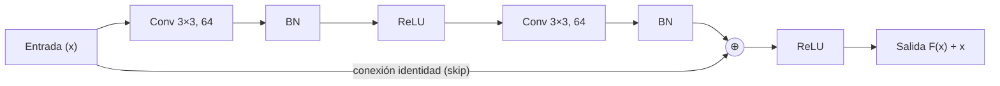
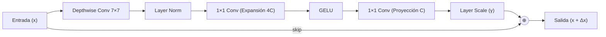

<!-- page:1 -->
# VGG

<!-- page:2 -->
<image id="img-001" kind="diagram" page="2">
text: "fc8" "fc7" "fc6" | "conv5-3" "conv5-2" "conv5-1" | "conv4-3" "conv4-2" "conv4-1" | "conv3-2" "conv3-1" | "conv2-2" "conv2-1" | "conv1-2" "conv1-1" | "Softmax" "FC 1000" "FC 4096" "Pool" "3 × 3 conv, 512" "3 × 3 conv, 256" "3 × 3 conv, 128" "3 × 3 conv, 64" "Input" | "VGG16" "VGG19"
description: Two vertical layer stacks side by side, drawn bottom (Input, gray) to top (Softmax, red). Orange boxes are 3 × 3 conv layers, blue boxes are Pool, green boxes are FC layers. Layer names (conv1-1 ... fc8) are written to the left of the VGG16 column only. VGG16 is the left column, VGG19 the right column (taller). Lists below read bottom to top.

VGG16:
| order | label | layer |
|---|---|---|
| 1 | | Input |
| 2 | conv1-1 | 3 × 3 conv, 64 |
| 3 | conv1-2 | 3 × 3 conv, 64 |
| 4 | | Pool |
| 5 | conv2-1 | 3 × 3 conv, 128 |
| 6 | conv2-2 | 3 × 3 conv, 128 |
| 7 | | Pool |
| 8 | conv3-1 | 3 × 3 conv, 256 |
| 9 | conv3-2 | 3 × 3 conv, 256 |
| 10 | | Pool |
| 11 | conv4-1 | 3 × 3 conv, 512 |
| 12 | conv4-2 | 3 × 3 conv, 512 |
| 13 | conv4-3 | 3 × 3 conv, 512 |
| 14 | | Pool |
| 15 | conv5-1 | 3 × 3 conv, 512 |
| 16 | conv5-2 | 3 × 3 conv, 512 |
| 17 | conv5-3 | 3 × 3 conv, 512 |
| 18 | | Pool |
| 19 | fc6 | FC 4096 |
| 20 | fc7 | FC 4096 |
| 21 | fc8 | FC 1000 |
| 22 | | Softmax |

VGG19:
| order | layer |
|---|---|
| 1 | Input |
| 2 | 3 × 3 conv, 64 |
| 3 | 3 × 3 conv, 64 |
| 4 | Pool |
| 5 | 3 × 3 conv, 128 |
| 6 | 3 × 3 conv, 128 |
| 7 | Pool |
| 8 | 3 × 3 conv, 256 |
| 9 | 3 × 3 conv, 256 |
| 10 | Pool |
| 11 | 3 × 3 conv, 512 |
| 12 | 3 × 3 conv, 512 |
| 13 | 3 × 3 conv, 512 |
| 14 | 3 × 3 conv, 512 |
| 15 | Pool |
| 16 | 3 × 3 conv, 512 |
| 17 | 3 × 3 conv, 512 |
| 18 | 3 × 3 conv, 512 |
| 19 | 3 × 3 conv, 512 |
| 20 | Pool |
| 21 | FC 4096 |
| 22 | FC 4096 |
| 23 | FC 1000 |
| 24 | Softmax |
</image>

<!-- page:3 -->
# MobileNet

<!-- page:4 -->
<image id="img-002" kind="diagram" page="4">
text: "conv1" "conv2" "conv3" "conv4" "conv5" | "fc6" "fc7" "fc8" | "224 × 224 × 64" "112 × 112 × 128" "56 × 56 × 256" "28 × 28 × 512" "14 × 14 × 512" "7 × 7 × 512" "1 × 1 × 4096" "1 × 1 × 1000" | "convolution+ReLU" "max pooling" "fully connected+ReLU"
description: 3D block diagram, left to right: a grayscale image slab (input) followed by stacks of blue convolution+ReLU slabs that shrink in spatial size, separated by red max pooling slabs, ending in thin green fully connected bars. Legend at lower right: blue = convolution+ReLU, red = max pooling, green = fully connected+ReLU. An arrow points up to the last red pooling slab from the label 7 × 7 × 512.
data:
| group | slabs | output size label |
|---|---|---|
| input | grayscale image | |
| conv1 | 2 blue | 224 × 224 × 64 |
| max pooling | 1 red | |
| conv2 | 2 blue | 112 × 112 × 128 |
| max pooling | 1 red | |
| conv3 | 3 blue | 56 × 56 × 256 |
| max pooling | 1 red | |
| conv4 | 3 blue | 28 × 28 × 512 |
| max pooling | 1 red | |
| conv5 | 3 blue | 14 × 14 × 512 |
| max pooling | 1 red | 7 × 7 × 512 |
| fc6 | 1 green | 1 × 1 × 4096 |
| fc7 | 1 green | 1 × 1 × 4096 (label shown under fc6/fc7 pair) |
| fc8 | 1 green | 1 × 1 × 1000 |
</image>

<!-- page:5 -->
# Resnet

<!-- page:6 -->
<image id="img-003" kind="diagram" page="6">
text: "ResNet-50" | "conv1" | "conv2_x (3 bloques)" "conv3_x (4 bloques)" "conv4_x (6 bloques)" "conv5_x (3 bloques)" | "Global Average Pooling" "fc" | "224 × 224 × 3" "112 × 112 × 64" "56 × 56 × 64" "56 × 56 × 64" "28 × 28 × 128" "14 × 14 × 256" "7 × 7 × 512" "1 × 1 × 512" "1 × 1 × 1000"
description: Top: left-to-right chain of colored blocks with arrows (grayscale input slab, blue conv1, red max pooling, green/purple/yellow/blue groups of residual blocks with curved skip arrows above each group, a blue Global Average Pooling block, a green fc block). The last block of each conv group is drawn with a dashed outline. Below it a legend box, then a detailed residual block diagram, then two dashed note boxes.

```mermaid
flowchart LR
  IN["Input 224 × 224 × 3"] --> C1["conv1 (7×7, stride 2) 112 × 112 × 64"]
  C1 --> MP["max pooling (3×3, stride 2) 56 × 56 × 64"]
  MP --> S2["conv2_x: 3 bloques, bloque residual 64 filtros 56 × 56 × 64"]
  S2 --> S3["conv3_x: 4 bloques, bloque residual 128 filtros 28 × 28 × 128"]
  S3 --> S4["conv4_x: 6 bloques, bloque residual 256 filtros 14 × 14 × 256"]
  S4 --> S5["conv5_x: 3 bloques, bloque residual 512 filtros 7 × 7 × 512"]
  S5 --> GAP["Global Average Pooling 1 × 1 × 512"]
  GAP --> FC["fc (1000 clases) 1 × 1 × 1000"]
```

Legend:
| color | element |
|---|---|
| blue | convolución (7×7, stride 2) |
| red | max pooling (3×3, stride 2) |
| green | bloque residual (64 filtros) |
| purple | bloque residual (128 filtros) |
| yellow | bloque residual (256 filtros) |
| blue | bloque residual (512 filtros) |
| light blue | global average pooling |
| green | fully connected (1000 clases) |

Residual block detail (green panel):

The group Conv 3×3, 64 → BN → ReLU → Conv 3×3, 64 is labeled F(x).

Text beside the block: "Cada bloque residual aprende una función residual F(x) = H(x) − x, y la salida es F(x) + x."

Note boxes (dashed):
- "Los bloques con línea discontinua realizan downsampling (stride 2) y usan proyección en la conexión skip (1×1 conv) para igualar dimensiones."
- "La suma elemento a elemento (⊕) permite que el gradiente fluya mejor en redes muy profundas."
</image>

<!-- page:7 -->
# Dense Net

<!-- page:8 -->
<image id="img-004" kind="diagram" page="8">
text: "DenseNet-121" | "conv0" "pool0" | "Dense Block 1 (6 capas)" "Dense Block 2 (12 capas)" "Dense Block 3 (24 capas)" "Dense Block 4 (16 capas)" | "Transition Layer 1" "Transition Layer 2" "Transition Layer 3" | "Global Avg Pooling" "fc" | "7×7 conv stride 2" "3×3 max pool stride 2" "k = 32" "1×1 conv 2×2 avg pool" | "224 × 224 × 3" "112 × 112 × 64" "56 × 56 × 64" "56 × 56 × 256" "28 × 28 × 128" "28 × 28 × 512" "14 × 14 × 256" "14 × 14 × 1024" "7 × 7 × 512" "7 × 7 × 1024" "1 × 1 × 1024" "1 × 1 × 1000"
description: Top: left-to-right chain; grayscale input slab, blue conv0, red pool0, then four colored dense blocks (green, purple, yellow, blue) each drawn as a row of thin slabs with "..." and many curved arrows above connecting every layer to all later layers; red transition layers between blocks; light-blue Global Avg Pooling; green fc. Below: a legend box, a Dense Layer detail panel, a "Conexiones Densas" panel, and two dashed note boxes.

```mermaid
flowchart LR
  IN["Input 224 × 224 × 3"] --> C0["conv0 (7×7 conv, stride 2) 112 × 112 × 64"]
  C0 --> P0["pool0 (3×3 max pool, stride 2) 56 × 56 × 64"]
  P0 --> D1["Dense Block 1 (6 capas), k = 32 56 × 56 × 256"]
  D1 --> T1["Transition Layer 1 (1×1 conv, 2×2 avg pool) 28 × 28 × 128"]
  T1 --> D2["Dense Block 2 (12 capas), k = 32 28 × 28 × 512"]
  D2 --> T2["Transition Layer 2 (1×1 conv, 2×2 avg pool) 14 × 14 × 256"]
  T2 --> D3["Dense Block 3 (24 capas), k = 32 14 × 14 × 1024"]
  D3 --> T3["Transition Layer 3 (1×1 conv, 2×2 avg pool) 7 × 7 × 512"]
  T3 --> D4["Dense Block 4 (16 capas), k = 32 7 × 7 × 1024"]
  D4 --> GAP["Global Avg Pooling 1 × 1 × 1024"]
  GAP --> FC["fc 1 × 1 × 1000"]
```

Legend:
| color | element |
|---|---|
| blue | convolución (7×7, stride 2) |
| red | max pooling (3×3, stride 2) |
| green | capa en bloque denso (BN–ReLU–Conv 3×3) crecimiento k = 32 |
| red | capa de transición (1×1 conv + avg pool 2×2) |
| blue | global average pooling |
| green | fully connected (1000 clases) |

Panel "Capa en un Bloque Denso (Dense Layer)": Entrada [x₀, x₁, ..., x_{l−1}] → BN → ReLU → Conv 3×3 → x_l. A path below carries "Concatenación de características ([x₀, x₁, ..., x_{l−1}, x_l])" from the input to the output.

Text beside it: "Cada capa recibe como entrada todas las características generadas por todas las capas anteriores dentro del mismo bloque (conexiones densas)."

Panel "Conexiones Densas": five slabs x₀, x₁, x₂, x₃, "...", x₄ with curved arrows from each slab to all later ones.

Note boxes (dashed):
- "Las conexiones densas realizan concatenación de características (no suma). Esto promueve la reutilización de características y mejora el flujo del gradiente."
- "Las capas de transición reducen el número de canales (compresión) y la resolución espacial para controlar la complejidad del modelo."
</image>

<!-- page:9 -->
# ConvNext-Base

<!-- page:10 -->
<image id="img-005" kind="diagram" page="10">
text: "ConvNeXt-Base" | "Stem" | "Stage 1 (3 bloques)" "Stage 2 (3 bloques)" "Stage 3 (9 bloques)" "Stage 4 (3 bloques)" | "Downsample 1 (Patch Merging)" "Downsample 2 (Patch Merging)" "Downsample 3 (Patch Merging)" | "Global Average Pooling" "fc" | "4 × 4 conv stride 4" "2 × 2 conv stride 2" | "224 × 224 × 3" "56 × 56 × 96" "28 × 28 × 192" "14 × 14 × 384" "7 × 7 × 768" "1 × 1 × 768" "1 × 1 × 1000"
description: Top: left-to-right chain; grayscale input slab, blue Stem, then four dashed rounded stage regions (green, purple, yellow, blue), each with a row of slabs and "...", separated by three red Downsample (Patch Merging) regions; light-blue Global Average Pooling; green fc. Below: a legend box, a ConvNeXt block detail panel, a blue "Características clave de ConvNeXt" panel, and two dashed note boxes.

```mermaid
flowchart LR
  IN["Input 224 × 224 × 3"] --> ST["Stem (4×4 conv, stride 4) 56 × 56 × 96"]
  ST --> S1["Stage 1 (3 bloques, dim = 96) 56 × 56 × 96"]
  S1 --> D1["Downsample 1, Patch Merging (2×2 conv, stride 2) 28 × 28 × 192"]
  D1 --> S2["Stage 2 (3 bloques, dim = 192) 28 × 28 × 192"]
  S2 --> D2["Downsample 2, Patch Merging (2×2 conv, stride 2) 14 × 14 × 384"]
  D2 --> S3["Stage 3 (9 bloques, dim = 384) 14 × 14 × 384"]
  S3 --> D3["Downsample 3, Patch Merging (2×2 conv, stride 2) 7 × 7 × 768"]
  D3 --> S4["Stage 4 (3 bloques, dim = 768) 7 × 7 × 768"]
  S4 --> GAP["Global Average Pooling 1 × 1 × 768"]
  GAP --> FC["fc 1 × 1 × 1000"]
```

Legend:
| color | element |
|---|---|
| blue | convolución (4×4, stride 4) |
| green | bloque ConvNeXt (dim = 96) |
| red | downsample / patch merging (2×2 conv, stride 2) |
| purple | bloque ConvNeXt (dim = 192) |
| yellow | bloque ConvNeXt (dim = 384) |
| blue | bloque ConvNeXt (dim = 768) |
| light blue | global average pooling |
| green | fully connected (1000 clases) |

Panel "Bloque ConvNeXt":

Panel "Características clave de ConvNeXt":
- Basado en CNNs modernas con diseño inspirado en Transformers.
- Usa depthwise convolutions grandes (7×7).
- Normalización LayerNorm en lugar de BatchNorm.
- Expansión con 1×1 conv (similar a MLP en Transformers).
- Layer Scale (γ) estabiliza el entrenamiento.
- Arquitectura simple pero altamente eficiente y escalable.

Note boxes (dashed):
- "Patch Merging: Reduce la resolución espacial a la mitad y duplica los canales (similar a un patch embedding de Transformers)."
- "Cada bloque mantiene la resolución espacial dentro del mismo stage y aumenta la capacidad representacional de forma profunda."
</image>
